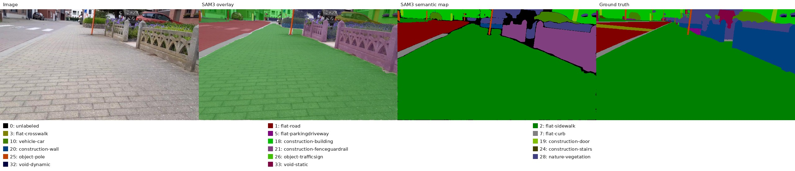
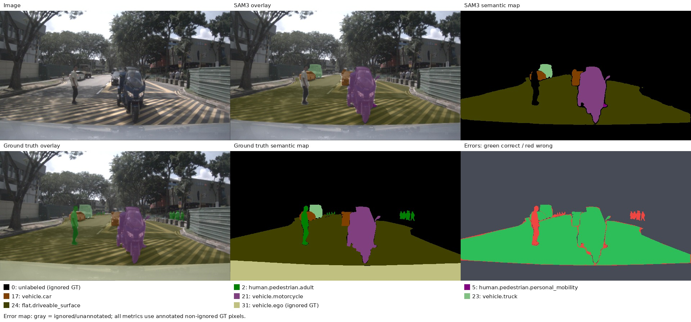
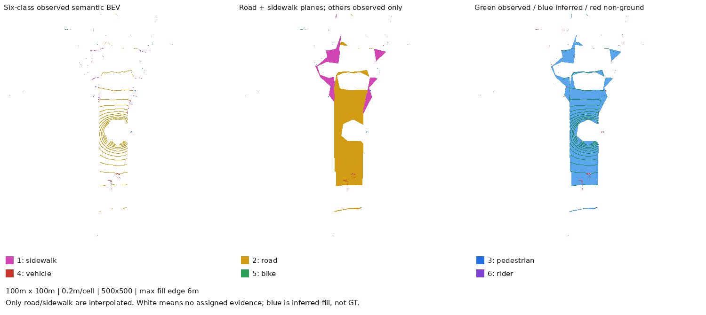
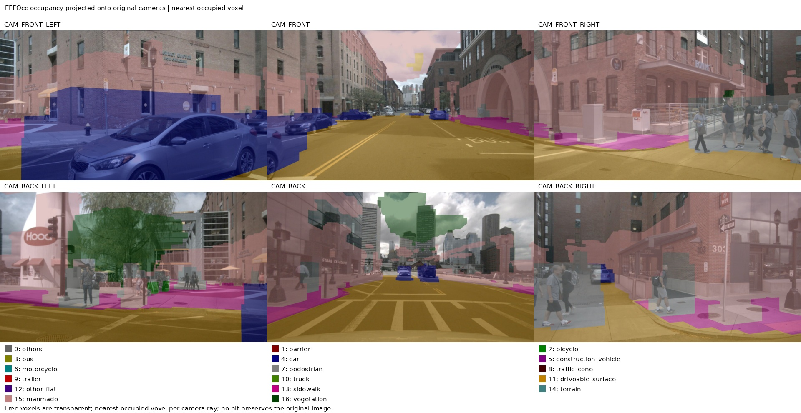
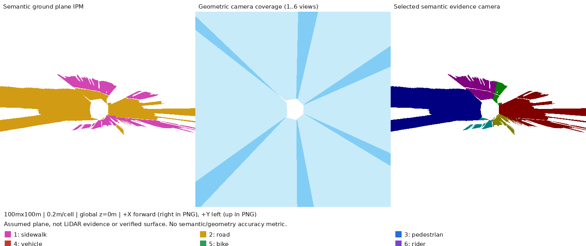

# vla-supervised-ad

[English](README.md) | **简体中文**

使用本地 SAM3 和 EFFOcc 完成图像语义分割、点云语义 BEV、占用预测及平地逆投影。项目划分为 **五类任务**；每类下方提供一键命令和真实运行的最终效果图。

所有命令从项目根目录的 **WSL Bash** 执行，入口自动使用已有 Conda **`vla-supervised`** 环境及本地权重。默认处理一张图或一帧六相机，不运行全数据集。

```bash
cd /mnt/d/wsl_workplace/vla-supervised-ad
```

| 任务 | 输入与目标 | 一键入口 |
|---|---|---|
| [1. Sidewalk Semantic](#task-sidewalk) | 图像分割，与像素 GT 比较 | `bash tasks/sidewalk/scripts/run.sh` |
| [2. nuImages](#task-nuimages) | 已标注相机图像分割与评估 | `bash tasks/nuimages/scripts/run.sh` |
| [3. nuScenes SAM3 与 BEV](#task-nuscenes) | 六相机分割、LiDAR 语义融合、道路/人行道铺面 | `bash tasks/nuscenes_sam3/scripts/run.sh` |
| [4. EFFOcc 与 SAM3 对比](#task-effocc) | 图像 + LiDAR 占用预测，投影到同帧相机比较 | `bash tasks/effocc/scripts/run.sh` |
| [5. 平地语义逆投影](#task-flat-ground) | 假设全局 z=0，把相机语义块直接投到地面 | `bash tasks/flat_ground/scripts/run.sh` |

详细安装、完整参数、数据路径和评估口径见 [中文详细指南](docs/guide.zh-CN.md)；[English guide](docs/guide.en.md)。以下图片均为实际输出的原图副本，保存在 [文档图片目录](docs/images/)，不依赖被忽略的实验输出目录。

<a id="task-sidewalk"></a>
## 1. Sidewalk Semantic：图像分割与像素评估

使用 SAM3 按 Sidewalk 数据集类别分割图像，输出语义类别图、叠加图、与数据集 GT 的对比，以及 mIoU、逐类 IoU 等像素指标。默认运行一张图。

```bash
bash tasks/sidewalk/scripts/run.sh
```

**最终效果：** 同一张图的原图、SAM3 预测与数据集真值对比。



类别提示词：[sidewalk_classes.txt](tasks/sidewalk/config/sidewalk_classes.txt)。输出位于 `outputs/sidewalk/<时间戳>/`，打开 `result.html` 查看，最终图片在 `results/`。高级自定义类别与评估规则见 [详细指南](docs/guide.zh-CN.md#1-使用-sidewalk-semantic-类别并评估)。

<a id="task-nuimages"></a>
## 2. nuImages：相机图像分割与真值对比

对 nuImages 有标注的相机关键帧做 SAM3 分割，解码数据集掩码，输出预测、GT 与错误图，并在有效标注像素上评估。默认运行一张图；不同样本不要求六视角均有标注。

```bash
bash tasks/nuimages/scripts/run.sh
```

**最终效果：** 上排为原图、SAM3 叠加和类别图；下排为 GT 叠加、GT 类别图和预测错误图。



类别提示词：[nuimages_classes.txt](tasks/nuimages/config/nuimages_classes.txt)。输出位于 `outputs/nuimages/<时间戳>/`，查看 `result.html` 和 `results/`。原始类别、ego 与忽略区域处理见 [详细指南](docs/guide.zh-CN.md#5-nuimages图像分割真值对比评估与可视化)。

<a id="task-nuscenes"></a>
## 3. nuScenes SAM3：六相机分割、语义 BEV 与地面铺面

六相机 SAM3 分割后，通过标定和位姿把类别回填至原始 LiDAR 点，跨相机融合，再生成语义 BEV。道路、人行道可在有点支持的局部三角网中铺成连续平面；补面来源单独保存。

```bash
# 标准 16 类：六相机、稀疏 lidarseg 评估、语义 BEV 与地面平面。
bash tasks/nuscenes_sam3/scripts/run.sh
```

类别现在直接从 [自定义类别配置](tasks/nuscenes_sam3/config/six_classes.txt) 读取，支持新增 crosswalk 等类别；旧入口名 `run_six_classes.sh` 继续保留。默认 sidewalk、road 铺面，其余类保留观测点；通过 `--plane-classes` 明确选择平面：

```bash
bash tasks/nuscenes_sam3/scripts/run_six_classes.sh
```

**最终效果（六类模式示例）：** 左侧为点云语义 BEV，中间为 road/sidewalk 铺面后的六类 BEV，右侧标记观测、推断填充及非地面证据。标准 16 类模式还会生成独立 GT BEV 和对比图。



默认范围 **100 m × 100 m**，粒度 **0.2 m**，对应 **500 × 500** 栅格；原生 LiDAR 坐标 +x 向右、+y 向上。标准入口输出至 `outputs/nuscenes_sam3/<时间戳>/`，`result.html` 顶部是 BEV 分区，图片集中到 `results/BEV/<帧>/`。六类入口输出至 `outputs/nuscenes_six_classes/<时间戳>/`，结果页优先展示 BEV。

提示词：[16 类配置](tasks/nuscenes_sam3/config/nuscenes_classes.txt)、[六类配置](tasks/nuscenes_sam3/config/six_classes.txt)。vehicle 包含汽车/卡车/公交/挂车，bike 包含自行车/摩托车，rider 是骑乘者本人。六类模式不直接沿用 16 类指标，lidarseg 也没有独立 rider 真值。

### 图形化生成器

不想输入命令参数时，启动本地生成器：

```bash
bash tasks/nuscenes_sam3/scripts/run_generator.sh
```

Windows 可双击或运行 `tasks\nuscenes_sam3\scripts\run_generator.bat`。浏览器打开 **http://127.0.0.1:8765**；服务在WSL的现有 `vla-supervised` 中运行，不额外安装Web框架。

界面支持增删类别、编辑对应英文提示词（`|`分隔别名）、逐类勾选“平面”，并通过复选框选择一个或多个mini场景。场景列表包含描述、帧数、训练/验证划分和本地可用状态，可搜索、筛选和全选。默认只生成所选场景合计1帧；勾选“生成所选场景的全部帧”才处理全部所选帧。高级参数支持起始帧、BEV地图分辨率、平面Z、补面最大边长、投影最大距离及GPU/CPU。

点击“预览配置”检查预估量，或直接“开始生成”。右侧显示运行状态、相机图像进度、实时日志、停止按钮、历史任务及“打开场景结果”。同一时间只运行一个生成任务。输出位于 `outputs/nuscenes_generator/<运行ID>/`，每次独立保存 `classes.txt`、`ui_config.json`、`job.json`、`run.log` 和 `output/`；**不会覆盖原提示词TXT**，输出类别/平面选择跟随该任务保存。停止后保留已生成文件，完整查看器以成功完成的结果为准。服务保持开启时可通过结果链接查看场景；离线也可打开输出中的HTML。

`--port 8766` 可更改端口，`--dataset-dir`、`--classes-file`、`--output-root` 可在启动UI时指定。关闭启动终端即可结束服务。

### 每个 Instance 的最小矩形 Bounding Box

新生成的场景HTML在图层区提供 **“实例矩形框 / Instance boxes”** 复选框，默认隐藏。勾选后3D场景和BEV Map都能显示每个实例的 **最小面积旋转矩形**；框独立于点云/平面显示开关，并跟随当前帧、全部帧及类别筛选。平面类别的实例也保留框，不把同类别区域合成一个框。

矩形覆盖该相机局部实例当前保留的全部支持点XY，不裁剪ROI、不人为加宽，Z放在该实例支持点高度中位数。启用SOR/DBSCAN时用清洗后点；关闭时用原始支持点。单点/共线点保留为点/线段，面积为0；无支持点实例保留空记录但不绘制。该框是可见点集的水平BEV包围框，不是3D检测框，也不保证覆盖被遮挡的完整物体；跨相机同一物体可能重复出现，框ID不是轨迹ID。

无需新增生成参数，现有UI、`run_scenes.sh` 和自定义分割入口自动生成。已有保存instance点归属的结果可以重新导出：

```bash
bash tasks/nuscenes_sam3/scripts/run_scenes.sh \
  --input-dir outputs/instance_filter_combined_verified/segmentation \
  --point-filter sor_dbscan --dbscan-eps 1.2 \
  --output-dir outputs/scene_with_instance_boxes
```

每帧保存 `scenes/<scene>/<sample_token>_boxes.json`，包含相机/实例ID、类别、支持点索引、四角坐标、中心、长宽、方向角和面积；场景 `manifest.json` 记录框统计及文件路径，HTML内嵌相同框几何。自定义分割和实例凸包输出还保存原生LiDAR坐标的 `instance_boxes.json`。旧结果没有实例点归属时不会用整个语义类别冒充实例，框开关会禁用；需先重新分割保存真实归属。

### Instance 支持点清洗：SOR / DBSCAN

生成器UI新增“实例点云清洗”算法选择：关闭（默认）、SOR、DBSCAN、SOR→DBSCAN，可展开调整参数。按每个相机局部SAM3实例的原始3D支持点单独清理，不把同类别的多个人/车合为一簇；跨相机同类保留点取并集。图片分割mask和零水平面IPM保持原预测，清洗用于染色支持点、点多边形及其BEV Map。未保留点的显示标签置0，原始坐标/类别/索引不删除。

```bash
bash tasks/nuscenes_sam3/scripts/run_scenes.sh \
  --scenes scene-0103 --samples 1 \
  --plane-classes sidewalk road crosswalk \
  --point-filter sor_dbscan \
  --sor-k 16 --sor-std 2 \
  --dbscan-eps 1.2 --dbscan-min-samples 5 \
  --cluster-policy significant --min-cluster-size 10 --cluster-ratio 0.1 \
  --output-dir outputs/filtered_scene
```

`--point-filter` 取 `none`、`sor`、`dbscan`、`sor_dbscan`，同参数也适用于 `run_six_classes.sh` 和 `run_instances.sh`。SOR按每点k个邻居平均距离，超出“总体均值 + sor_std × 总体标准差”删除；k不包含自身，少量点自动缩小k，最多2点时SOR保留。DBSCAN的eps单位米、min-samples包含自身；`largest` 仅保留最大簇，`significant` 保留点数不少于 `max(min-cluster-size, 最大簇点数×cluster-ratio)` 的簇，噪声及未达条件的团块删除。没有有效簇时该实例可能被全部清除，不会悄悄退回原点集。

**稀疏远处真实目标也可能被清除**，尤其crosswalk/行人支持点少时。初次建议先用SOR或较小min-cluster-size/较大eps，并查看清洗对比，不能把清洗当作精度提升保证。场景索引提供“清洗对比”，`scenes/<scene>/cleaning/<sample>/` 保存原/清洗标签、保留掩码、移除点索引、逐实例JSON及红绿对比图。新分割保存 `point_instances.json` 供以后在 `run_scenes.sh --input-dir ... --point-filter ...` 中更换算法，无需重跑SAM3；旧结果若没有实例点归属会明确要求重新生成，不会用语义类别冒充实例。

### 自选平面类别（含 crosswalk）

提示词TXT决定 **识别哪些类别**，`--plane-classes` 决定 **其中哪些生成平面**；两者分开配置。你新增的crosswalk保留原提示词，当前七类ID按文件顺序为sidewalk1、road2、crosswalk3、pedestrian4、vehicle5、bike6、rider7。颜色和rider/行人冲突处理按类别名称，不固定旧ID。

```bash
# 从头识别：道路、人行道、人行横道均生成平面与BEV Map。
bash tasks/nuscenes_sam3/scripts/run_scenes.sh \
  --scenes scene-0103 --samples 0 \
  --plane-classes sidewalk road crosswalk \
  --output-dir outputs/scene_with_crosswalk_planes

# 已有包含crosswalk的分割结果：只让road铺面，其余类显示为染色点云。
bash tasks/nuscenes_sam3/scripts/run_scenes.sh \
  --input-dir outputs/crosswalk_planes_verified/segmentation \
  --plane-classes road \
  --output-dir outputs/road_plane_only
```

参数同时作用于零水平面IPM、点多边形、BEV Map和HTML，选中的平面类别仍分别保留标签；也适用于 `run_six_classes.sh --plane-classes ...` 与 `tasks/flat_ground/scripts/run.sh --plane-classes ...`（旧 `--project-classes` 是同义参数）。默认不额外把crosswalk当平面，需明确加入；新运行默认sidewalk/road，复用结果不指定时优先沿用保存的平面选择。未列入的已识别类仍有分割/点云，不被删除；在HTML中可通过类别开关隐藏。

每次输出保存自己的 `classes.json`、配置taxonomy和plane_class_ids，旧结果按自己的类别表解释。改TXT后不会把旧pedestrian3误解释为新crosswalk3；旧分割没有crosswalk时须重跑分割才能增加该类别。每个类别是单标签掩码，已接受的crosswalk优先覆盖road/未分配像素，避免同片道路覆盖斑马线；这仍受提示词分割误差影响。

### 场景 HTML：两种路面、染色点云与时间轴

六类入口现在自动生成 `scenes/index.html` 场景目录，每个场景一个可离线打开的 `scenes/<scene>/viewer.html`。页面可在 **零水平面 IPM** 与 **BEV 点多边形** 两种道路/人行道平面之间切换或同时显示；行人、车辆、bike、rider 仍直接渲染原始三维染色点，不做物体平面扩展。

- 时间轴拖动、前后帧按钮、播放/暂停和 FPS 选择；也可一次叠加显示该 HTML 内的全部帧。
- 路面方法、染色点、地面支持点、自车轨迹分别开关；sidewalk、road、pedestrian、vehicle、bike、rider 各类独立显示/隐藏，未分配点默认为隐藏。
- 鼠标旋转、右键/Shift平移、滚轮缩放；提供俯视、3D、适应场景按钮、点大小及平面透明度调整。

直接生成一个完整场景（`--samples 0` 表示当前筛选下的全部帧）：

```bash
bash tasks/nuscenes_sam3/scripts/run_scenes.sh \
  --scenes scene-0103 --samples 0 \
  --output-dir outputs/my_scene_viewer
```

已有六类输出无需重新分割：

```bash
bash tasks/nuscenes_sam3/scripts/run_scenes.sh \
  --input-dir outputs/nuscenes_six_classes/20261016_135902_151161 \
  --output-dir outputs/my_saved_scene_viewer
```

有 `--input-dir` 时默认导出已有的全部帧；无输入时默认只运行一帧。输入含多个场景会分别生成 HTML，索引明确显示“已导出帧数 / 数据集场景总帧数”，不会将部分结果称为完整场景。六类入口的普通 `result.html` 会链接到场景查看器，`--no-scene-viewer` 可跳过附加导出。

两种路面和点云都通过各传感器时间戳的位姿，对齐到场景首个显示帧的自车XY/yaw坐标系，单位米。IPM 保持全局 `z=0`；点多边形沿用0.2米栅格、最大6米边长的局部补面，再按该类观测点的全局高度中位数放置为水平片。原始三维点保留完整坐标和索引，不抽样、不压平；多帧叠加保留动态物体轨迹，不做跟踪。每帧NPZ和场景 `manifest.json` 保存变换、路面标签、精确逐行矩形/三角形及支持计数；矩形网格化保留孔洞，不会用凸包跨越未填充区域。HTML内嵌全量数据且不依赖CDN/服务器；较长场景的文件和显存占用随帧数增加。

### BEV Map：将路面分成固定米制格子

场景查看器新增 **BEV Map** 按钮，可在原3D场景与正交栅格地图之间切换。零水平面IPM与BEV点多边形两种平面分别重采样到同一场景XY格网，默认 **0.2米/格**；单帧显示当前帧地图，“全部帧”显示按格融合的场景地图。方法下拉框选择 IPM/Polygon，不改变3D图层；类别开关控制road/sidewalk格子和其它类别点云叠加。可拖动平移、滚轮缩放、显示细网格及导出PNG。

新运行 `run_scenes.sh` 或六类管线会自动包含地图。已有场景可直接升级，无需重新分割或投影：

```bash
bash tasks/nuscenes_sam3/scripts/run_bev_map.sh \
  --input-dir outputs/nuscenes_scene0103_complete/scenes \
  --map-resolution 0.2 \
  --output-dir outputs/nuscenes_scene0103_bev_map
```

`run_scenes.sh --map-resolution 0.4` 可改变新导出地图的格子大小。场景地图按整段路面范围建立，不固定为单帧500x500；本次scene-0103的40帧为 **1086x597格、217.2米x119.4米**。坐标仍是场景首帧自车XY/yaw，+X向右、+Y向上。

每个目标格用格子中心反查原平面格网，不新增膨胀/插值填洞。全帧融合每帧每格最多一票；票数多的类别胜出，平票取sidewalk（ID1），无标签为0并弃票。`conflict` 标记曾同时得到road与sidewalk证据的格子；`observation_count` 是有标签的帧数，**不是实测地面次数**。缺证据区域不是可通行空间。地图显示压平高度，原3D点和面数据保留。

每场景 `bev_map/` 保存：两种方法的 `ipm_map.png` / `polygon_map.png`、`*_fused.npz`（labels、class_votes、observation_count、conflict、tie）、`*_conflicts.png`、每帧 `<sample_token>.npz` 和 `metadata.json`。HTML内嵌单帧/融合标签，可离线使用；升级保留原场景数值数据路径供后续重新导出。

同属本任务的扩展实验：

| 扩展 | 入口 | 用途 |
|---|---|---|
| 实例点凸包 | `bash tasks/nuscenes_sam3/scripts/run_instances.sh` | 保留相机实例，把分配点覆盖成凸包，含独立合并/地面结果 |
| 已有结果跨相机合并 | `bash tasks/nuscenes_sam3/scripts/merge_instances.sh --input-dir <已有实例输出>` | 同类前景共享点关联、点集去重、重算凸包 |
| 已有结果补地面平面 | `bash tasks/nuscenes_sam3/scripts/run_ground.sh --input-dir <已有输出>` | 复用分割/点预测，不重跑 SAM3 |
| 刷新旧一键结果页 | `bash tasks/nuscenes_sam3/scripts/run.sh --refresh-results --output-dir <已有一键输出>` | 补地面图并集中展示 BEV |

平面填充不是新增观测；稀疏投影点评估不是密集图像 GT。完整融合、边界与指标说明见 [详细指南](docs/guide.zh-CN.md)。

<a id="task-effocc"></a>
## 4. EFFOcc：占用预测与 SAM3 同帧对比

EFFOcc Fusion-R18 同时使用六相机图像和 LiDAR/历史扫帧预测三维语义占用，再把占用射线投影回六相机，与独立 SAM3 分割比较。一条命令自动完成两个模型阶段和对比图。

```bash
bash tasks/effocc/scripts/run.sh
```

**最终效果（前视相机示例）：** 左为原图，中为 SAM3 图像分割，右为同帧 EFFOcc 占用投影。运行结果还包含完整六相机对比图。



输出位于 `outputs/effocc/<时间戳>/`：`result.html` 展示最终对比，图片在 `results/`，原始占用与投影在 `raw/`，SAM3 对比在 `comparison/`。SAM3 提示词使用 [nuScenes 16 类配置](tasks/nuscenes_sam3/config/nuscenes_classes.txt)；EFFOcc 本身没有文本提示词，类别由训练权重固定。

当前是严格加载检查点的推理用 PyTorch 适配实现，没有完成与原始 MMCV/spconv 后端的全量数值等价验证。本地缺少密集占用 GT；两模型差异只作视觉比较，不是准确率。详见 [EFFOcc 指南](docs/guide.zh-CN.md#6-在-nuscenes-mini-上运行-effocc-fusion-r18)。

<a id="task-flat-ground"></a>
## 5. 平地语义逆投影：直接投到 z=0 地面

假设地面为 **nuScenes 全局地图坐标 z=0** 的水平面，用相机内外参及各自时刻的位姿，把 SAM3 语义块直接映射到地面。采用 BEV 格子中心反查相机像素的 IPM，不读取 LiDAR 点、不做三角网补面。默认只投 road、sidewalk。

```bash
bash tasks/flat_ground/scripts/run.sh
```

**最终效果：** 左为融合后的平地语义 BEV，中为几何相机覆盖，右为最终标签的来源相机。该图与任务 3 的点云 BEV 坐标不同：+X 是自车前方（图中向右），+Y 是左侧（图中向上）。



默认仍为 **100 m × 100 m、0.2 m、500 × 500**，输出至 `outputs/flat_ground/<时间戳>/`，打开 `result.html`。可复用任务 3 保存的六类掩码，无需重新推理：

```bash
bash tasks/flat_ground/scripts/run.sh \
  --input-dir outputs/nuscenes_six_class_planes \
  --plane-z 0 \
  --output-dir outputs/flat_ground_demo
```

`--plane-z` 指全局地图高度，不是海平面绝对海拔。坡度、路沿高度、遮挡和分割误差会造成变形；白色区域表示缺少有效地面标签。若用 `--project-classes sidewalk road pedestrian vehicle bike rider` 投全部六类，高于地面的物体会被拉伸，不能视为真实接地轮廓。投影公式、参数及证据文件见 [平地 IPM 指南](docs/guide.zh-CN.md#平地ipm把语义块直接投到-z0)。

## 环境、参数与详细说明

- 环境固定使用 WSL 的 `vla-supervised`；[环境配置](docs/guide.zh-CN.md#环境配置) 中保留完整安装、依赖和数据检查步骤。
- 五个任务均默认只跑一个样本。使用 `--samples N` 扩大范围，`--start-index I` 选择起始位置，`--output-dir` 指向新/空目录；每个入口的 `--help` 显示实际支持的参数。
- Sidewalk、nuImages、标准 nuScenes 和 EFFOcc 一键入口的最终图集中于 `results/`；六类与平地任务直接按帧保存最终图，并提供同样可打开的 `result.html`。
- 运行全项目验证：`bash shared/scripts/test_all.sh`。环境、权重、数据和历史实验输出均不随文档调整而移动。

[完整命令参考](docs/guide.zh-CN.md#可用命令总表) · [项目目录与数据路径](docs/guide.zh-CN.md#项目目录与数据路径) · [English detailed guide](docs/guide.en.md)
